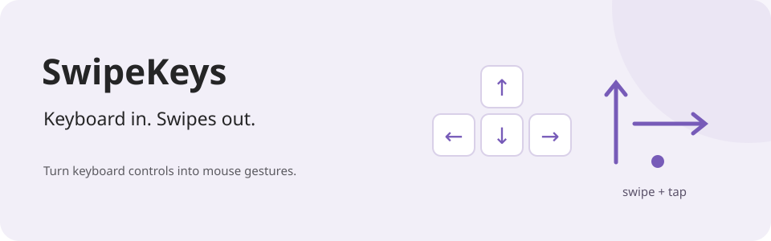

# SwipeKeys

**Keyboard in. Swipes out.**



A small native macOS app that turns keyboard controls into mouse gestures.
Use it with games that expect swipes and taps.

[**Download for macOS →**](https://github.com/nickdrezza/SwipeKeys/releases/latest)

## Play from the keyboard

| Key | Action |
| --- | --- |
| Arrow keys | Swipe in that direction. |
| Enter | Tap. |
| `Command + Control + Option + K` | Turn SwipeKeys on or off. |

Gestures happen around the cursor. The original key presses still pass through.
Open **Edit** to select `WASD + Space` or set custom bindings.

## Install

1. Download `SwipeKeys-macOS.zip` from the [latest release](https://github.com/nickdrezza/SwipeKeys/releases/latest).
2. Unzip it and move `SwipeKeys.app` to Applications.
3. Open the app and select **Permissions**.
4. Enable **Accessibility** and **Input Monitoring** in System Settings.
5. Reopen the app if macOS asks.

Requires macOS 14 or later. Keep the cursor where the game expects the gesture.
You can check both permissions from the app's **Permissions** page.

## Build from source

Install Apple's command-line developer tools with Swift 6 or later.

```sh
git clone https://github.com/nickdrezza/SwipeKeys.git
cd SwipeKeys
./Scripts/build-app.sh
```

The app is created at `dist/SwipeKeys.app`.

## Why I made it

I made this to play Subway Surfers City on my MacBook after enjoying the game a
bit too much.

Made by [nickdrezza](https://nickdrezza.com).

## License

This project is licensed under [GNU AGPLv3 only](LICENSE) (`AGPL-3.0-only`).
See [NOTICE](NOTICE) for copyright information.

You can use, change, and sell copies under the license terms.
If you distribute covered code, provide its source under the same license.
If you change the project and let users access it over a network,
offer those users the source of your version.

Earlier releases keep the license terms that applied to them.
